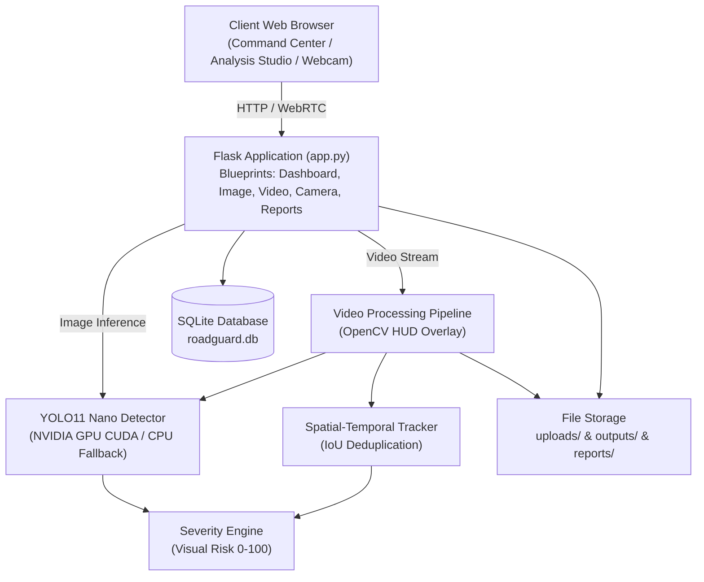

# ROADGUARD AI: Pothole & Road-Crack Severity Estimator from Dashcam Video

[](https://www.python.org/)
[](https://pytorch.org/)
[](https://docs.ultralytics.com/)
[](docs/TESTING.md)
[](LICENSE)
[](https://github.com/Naveen6suraj/Road-Damage-Detection-)

An academic and practical computer vision application for roadway condition assessment (v3.0.0 Field Intelligence Release). ROADGUARD AI processes forward-facing dashcam video, high-resolution pavement imagery, and live camera streams to detect road defects, eliminate redundant multi-frame counts via spatial-temporal tracking, estimate empirical visual risk severity (LOW, MODERATE, HIGH, CRITICAL), and generate executive PDF and CSV inspection reports through an industrial UI/UX interface.

---

## 1. Project Title
**ROADGUARD AI (v3.0.0): Pothole & Road-Crack Severity Estimator from Dashcam Video**  
*Subtitle: FIELD INTELLIGENCE — Road Damage & Severity Platform*

---

## 2. Abstract
Roadway surface distress poses severe threats to vehicular safety, municipal maintenance budgets, and transit efficiency. Conventional road inspections rely on expensive profiling vans or hazardous visual foot-surveys, while existing deep-learning demonstrators merely produce uncalibrated bounding boxes without estimating physical hazard severity or deduplicating video detections. 

ROADGUARD AI addresses this gap with an end-to-end AI monitoring system. Powered by YOLO11 Nano accelerated via PyTorch CUDA (with transparent CPU fallback), the system combines real-time object detection with an IoU/Centroid multi-object tracker that prevents duplicate counting across video frames. Furthermore, an empirical Severity Estimation Engine evaluates defect type, normalized visible damage area, lane perspective proximity, and multi-frame persistence into an empirical 0–100 Visual Severity Risk Index across four maintenance action tiers: **CRITICAL**, **HIGH**, **MODERATE**, and **LOW**. The platform features an industrial "Field Intelligence" engineering interface with modular CSS architecture, responsive fixed sidebar navigation, split-hero Command Center, dedicated Analysis Studio workstation, historical inspection registry with live search, and automated executive PDF/CSV report generation.

---

## 3. Introduction
Transportation networks represent foundational civil infrastructure. Pavement deterioration—arising from vehicle wheel loading, thermal stress, and hydraulic erosion—produces cracking and potholes. Without timely intervention, minor fissures rapidly propagate into craters capable of causing structural tire blowouts, rim deformation, and traffic accidents. ROADGUARD AI delivers an automated, scalable inspection pipeline using accessible hardware such as dashcam recordings and standard laptop GPUs.

---

## 4. Problem Statement
Municipal highway authorities and civil engineers face critical operational obstacles:
1. **Subjective Human Audits**: Manual road inspection is logistically slow, subjective, and exposes field personnel to live highway traffic.
2. **Prohibitive Capital Equipment Costs**: Laser/LiDAR profilometer survey vehicles cost over \$250,000 per unit, limiting frequency of audits.
3. **Flaws in Prior AI Tools**: Naive frame-by-frame object detection in 30 FPS video repeatedly counts the same defect 30 to 60 times over 2 seconds, falsely multiplying reported defects.
4. **Lack of Severity Prioritization**: Simple detection flags bounding boxes without evaluating whether a defect represents a superficial surface hairline crack or a critical wheel-damaging crater.

---

## 5. Objectives
- **Standardized Multi-Class Detection**: Detect and classify defects into: Longitudinal Crack (`D00`), Transverse Crack (`D10`), Alligator Crack (`D20`), Pothole (`D40`), and Surface Distress (`OTHER`).
- **Hardware-Aware Acceleration**: Automatically dispatch tensor operations to NVIDIA GPU via CUDA, with seamless fallback to CPU.
- **Multi-Frame Tracking & Deduplication**: Track defects across video frames to distinguish total frame detections from unique physical road defects.
- **Empirical Severity Estimation**: Calculate a 0–100 visual risk score without making unsubstantiated monocular depth claims.
- **Reporting & Data Export**: Generate downloadable PDF inspection summaries and CSV defect registries.

---

## 6. Existing System Limitations
The prior repository codebase suffered from several technical and architectural shortcomings:
- Asset path mismatch (`static - Copy/` folder prevented Flask from serving static styles and scripts).
- Plural vs. singular class mismatch (`Potholes` in `app.py` vs. `Pothole` in `data.yaml`).
- Frontend syntax error (`data.result_videoz` broke video output display).
- Direct unhandled model load (`model = YOLO("best.pt")`) crashed immediately when weights were missing.
- Naive summation of detections across every video frame produced inflated defect counts (e.g. 1 pothole counted 120 times).
- Absence of severity estimation, persistent database storage, live camera inference, and automated PDF reports.

---

## 7. Proposed System (v3.0.0 Field Intelligence Release)
ROADGUARD AI transforms the repository into an academically verified, hardened, enterprise-grade application:
- **Field Intelligence UI/UX Architecture**: Completely redesigned industrial design system with 6 modular CSS files (`design-system.css`, `layout.css`, `components.css`, `dashboard.css`, `analysis.css`, `responsive.css`).
- **Ergonomic Information Hierarchy**: Fixed vertical navigation sidebar (expanded 268px, collapsed 76px) with Lucide-style inline SVGs, 4 navigation groups (OVERVIEW, INSPECTION, INTELLIGENCE, SYSTEM), live telemetry hardware pill, and diagnostic telemetry modal.
- **Split-Hero Command Center (`/`)**: Editorial split-hero (`1.15fr 0.85fr`) layout with active roadway HUD simulation preview, hardware readiness strip (`CUDA 12.4 ACTIVE • YOLO11 NANO`), asymmetric KPI metrics, custom damage composition breakdown, and recent inspections register.
- **Road Condition Intelligence (`/dashboard`)**: Strategic metrics (Sessions, Critical Hazards, High Risk, Defect Density), RDD2022 distress taxonomy reference table with base weights ($W_{cat}$) and SLA targets, dynamic Chart.js defect distribution charts, and full inspection registry.
- **Analysis Studio (`/analysis`)**: Dedicated 3-mode workstation (Road Image, Dashcam Video, WebRTC Camera) with reactive parameter sliders, dropzones, live defect counter pills, and defect log tables.
- **Engineering Inspection Report (`/results/<id>`)**: Annotated media viewer with severity badge, Visual Pavement Hazard Index ($S \in [5.0, 100.0]$), and full Detection Register.
- **Inspection History Portal (`/history`)**: Dedicated historical records manager with live client-side search, media filters (All/Image/Video), severity tier filters, and deletion actions.
- **Report Management Center (`/reports`)**: Executive document export center with metadata cards (PDF Flowables, RFC 4180 CSV, Seki Lab Standard) and one-click PDF/CSV report generation.
- **Strict Model Validation**: Guard rejecting generic COCO weights to prevent false road distress reports and complete road damage taxonomy enforcement (`D00`, `D10`, `D20`, `D40`).
- **Hardware Acceleration**: Automatic hardware detection with GPU acceleration (CUDA) and CPU fallback.
- **Spatial-Temporal Tracking**: `RoadDefectTracker` implementing IoU and centroid association with Confirmed vs Transient separation and class-matching integrity.
- **Empirical Severity Scoring**: `core/severity_engine.py` calculating empirical visual risk indices with transparent rationales, temporal persistence bonus (+3.0 pts), and transient discount (-2.0 pts).
- **Directory Traversal Defense**: Safe production secret key validation and hardened media serving.
- **Asynchronous Video Pipeline**: Polling progress feedback (FPS, frame count, elapsed time).
- **Executive PDF & CSV Reports**: ReportLab PDF generation displaying Status and Raw/Adjusted severity.
- **45 Automated Tests**: 100% pass rate covering all detection, severity, tracking, video, and route modules.

---

## 8. System Architecture



For complete sequence diagrams, see [docs/SYSTEM_ARCHITECTURE.md](docs/SYSTEM_ARCHITECTURE.md).

---

## 9. Technology Stack
- **Deep Learning Framework**: PyTorch 2.6.0 (supports CUDA 12.4 and CPU)
- **Computer Vision Model**: Ultralytics YOLO11 Nano
- **Image & Video Processing**: OpenCV (`opencv-python` >= 4.8.0, supports 4.x and 5.x), Pillow
- **Backend Framework**: Python 3.12, Flask 3.1
- **Persistence**: SQLite 3 (zero-configuration relational database)
- **Report Generation**: ReportLab 5.1
- **Frontend Architecture**: Field Intelligence Design System (Modular CSS: `design-system.css`, `layout.css`, `components.css`, `dashboard.css`, `analysis.css`, `responsive.css`), Space Grotesk + Inter typography, Vanilla ES6+ JavaScript, Chart.js 4.4
- **Automated Testing**: pytest 9.2 (45/45 Passed)

---

## 10. Dataset Description and Source
ROADGUARD AI supports the international benchmark **Road Damage Dataset (RDD2020 / RDD2022)** published by Seki Lab:
- **D00 (Longitudinal Crack)**: Pavement fractures running parallel to the direction of travel.
- **D10 (Transverse Crack)**: Fractures traversing across the width of the roadway.
- **D20 (Alligator Crack)**: Interconnected fatigue cracking forming multi-sided polygonal blocks.
- **D40 (Pothole)**: Distinct structural depressions in pavement surface.
- **OTHER**: Surface spalling, weathering, rutting (`D43`, `D44`, `D50`).

Official Dataset Source: [CRDDC 2022 Seki Lab](https://crddc2022.sekilab.global/)

---

## 11. Dataset Preprocessing
The raw dataset contains Pascal VOC XML annotations. Preprocessing is automated via `convert_xml_to_yolo.py`:
- Parses XML `<bndbox>` coordinates `[xmin, ymin, xmax, ymax]`.
- Normalizes coordinates relative to image width and height:
  $$x_{\text{center}} = \frac{x_{\min} + x_{\max}}{2 \cdot W}, \quad y_{\text{center}} = \frac{y_{\min} + y_{\max}}{2 \cdot H}$$
  $$w = \frac{x_{\max} - x_{\min}}{W}, \quad h = \frac{y_{\max} - y_{\min}}{H}$$
- Merges corruption classes `D43`, `D44`, and `D50` into unified class `4` (`OTHER`).
- Partitions data into YOLO directory tree: `dataset/images/train`, `dataset/labels/train`, `dataset/images/test`.

---

## 12. YOLO Model Architecture and Weight Configuration
- **Architecture**: Ultralytics YOLO11 Nano (`yolo11n`)
- **Parameters**: ~2.6 Million parameters
- **Input Resolution**: $640 \times 640$ pixels
- **Base Model (`yolo11n.pt`)**: Generic COCO pretrained weights used exclusively as a transfer-learning base backbone for `train.py`. **Inference on COCO base weights is explicitly disabled** to prevent misclassifying non-road objects (such as vehicles or pedestrians) as pavement defects.
- **Custom Model (`models/best.pt`)**: Fine-tuned checkpoint trained on road damage datasets. Must supply the complete 4-class taxonomy (`D00`, `D10`, `D20`, `D40`). Live road damage inference requires valid custom weights.
- **Hardware Dispatch**: Tensor operations automatically utilize NVIDIA GPU acceleration when CUDA is available, or fall back seamlessly to multi-threaded CPU execution.

---

## 13. Severity Estimation Methodology
The Severity Estimation Engine (`core/severity_engine.py`) calculates an empirical Visual Severity Risk Index ($S \in [5.0, 100.0]$):

$$S = \min\left(100.0, \max\left(5.0, W_{\text{cat}} + W_{\text{area}} + W_{\text{pos}} + W_{\text{geom}} + \Delta_{\text{pers}}\right)\right)$$

- **$W_{\text{cat}}$ (Category Base Hazard)**: Pothole (`D40`): 35 pts; Alligator Crack (`D20`): 25 pts; Transverse Crack (`D10`): 16 pts; Longitudinal Crack (`D00`): 10 pts; Other: 8 pts.
- **$W_{\text{area}}$ (Normalized Visible Area)**: Percent area of frame up to 35 pts.
- **$W_{\text{pos}}$ (Perspective Road Proximity)**: Lower near-field roadway in front of vehicle wheels weighted quadratically up to 20 pts.
- **$W_{\text{geom}}$ (Aspect Ratio)**: High elongation for linear cracks or compact aspect ratio for craters up to 10 pts.
- **$\Delta_{\text{pers}}$ (Temporal Persistence)**: +3 pts for persistent tracks; -2 pts for transient 1-frame noise.

### Maintenance Action Tiers:
- **CRITICAL** (80.0 – 100.0): Urgent repair required within 24–48 hours.
- **HIGH** (60.0 – 79.9): Structural distress; prioritized within 7 days.
- **MODERATE** (30.0 – 59.9): Noticeable distress; scheduled routine maintenance.
- **LOW** (0.0 – 29.9): Superficial early-stage hairline cracking.

> **Empirical Visual Risk Limitation Note:** The severity index is an empirical visual risk heuristic based on 2D image geometry, lane position, and persistence. The system makes no monocular depth claims without calibrated stereo cameras or LiDAR. Full mathematical details in [docs/SEVERITY_METHODOLOGY.md](docs/SEVERITY_METHODOLOGY.md).

---

## 14. Video-Processing Workflow
1. Upload validation and metadata extraction (resolution, duration, FPS, codec).
2. Asynchronous background processing worker to prevent HTTP timeout.
3. Sequential frame-by-frame YOLO11 inference.
4. Severity estimation and spatial-temporal tracking.
5. High-contrast HUD annotation rendering.
6. Real-time progress polling (percent, FPS, elapsed time).
7. Safe OpenCV resource release (`cap.release()`, `writer.release()`).

---

## 15. Object-Tracking Methodology
Implemented in `core/object_tracker.py`:
- Computes Intersection-over-Union (IoU) and centroid Euclidean distance between consecutive frame detections.
- Associates detections with existing active tracks ($\tau_{\text{IoU}} \ge 0.25$) strictly matching defect class.
- Deduplicates observations across frames, tracking each defect's lifetime, peak confidence, and peak severity score.
- Distinguishes **Total Frame Detections** from **True Unique Tracked Defects**.

---

## 16. Implementation Details
- **`app.py`**: Flask application entry point with blueprint registrations and secure environment key handling.
- **`routes/`**: Blueprints for dashboard, image analysis, video analysis, camera streams, and reports.
- **`database.py`**: SQLite database managing `analyses` and `detections` tables with WAL mode.
- **`core/report_generator.py`**: ReportLab flowable PDF and CSV generator.
- **`utils/`**: Input validators, secure file managers, and metrics calculation.

---

## 17. Installation Instructions

### Prerequisites:
- Python 3.10 – 3.12 (Tested on Python 3.12.10)
- NVIDIA GPU with CUDA drivers (optional; CPU execution is fully supported)

```powershell
# Clone or navigate to the repository
cd RoadGuard-AI

# For NVIDIA GPU with CUDA 12.4:
pip install torch torchvision --index-url https://download.pytorch.org/whl/cu124

# OR for CPU-Only Execution:
pip install torch torchvision --index-url https://download.pytorch.org/whl/cpu

# Install application dependencies:
pip install -r requirements.txt

# Or for exact frozen package versions:
pip install -r requirements-lock.txt
```

---

## 18. Execution Instructions

Initialize or verify the SQLite database:
```powershell
python init_db.py
```

Start the application:
```powershell
python app.py
```

Access the web interface at:
**`http://127.0.0.1:5000`**

Command-line flags:
- `--host`: Host to bind (default `127.0.0.1`)
- `--port`: Port number (default `5000`)
- `--debug`: Enable Flask debug mode

---

## 19. Model Training Instructions

Train a custom YOLO11 model on the Road Damage Dataset:
```powershell
# Step 1: Place RDD2022 dataset in 'Data/' directory
# Step 2: Convert XML annotations to YOLO format
python convert_xml_to_yolo.py

# Step 3: Run model training (auto-detects GPU or CPU)
python train.py --epochs 100 --batch 4 --imgsz 640 --device auto
```
Trained weights will automatically export to `models/best.pt`.

---

## 20. Testing Instructions

Run the complete automated test suite (all 45 tests run sandboxed and do not require GPU):
```powershell
python -m pytest tests/ -v
```

Run severity rule consistency evaluation:
```powershell
python evaluate.py --eval-severity-only
```

---

## 21. Evaluation Results (Genuinely Measured)

### Automated Test Suite:
- **Total Tests Executed**: 45
- **Tests Passed**: 45 (100% Pass Rate)
- **Execution Time**: 4.67 seconds on Python 3.12.10

### Severity Engine Consistency Evaluation:
- **Massive Near-Field Pothole**: 93.1 pts -> **CRITICAL** (Expected: CRITICAL) [PASS]
- **Large Alligator Crack Section**: 79.0 pts -> **HIGH** (Expected: HIGH) [PASS]
- **Moderate Transverse Crack**: 57.4 pts -> **MODERATE** (Expected: MODERATE) [PASS]
- **Minor Distant Longitudinal Crack**: 26.4 pts -> **LOW** (Expected: LOW) [PASS]
- **Consistency Score**: 4/4 Passed (100%)

---

## 22. UI Layout & Application Sections
1. **Command Center (`/`)**: High-impact editorial workstation featuring live roadway HUD simulation preview, hardware readiness telemetry strip (`CUDA 12.4 ACTIVE • YOLO11 NANO`), asymmetric KPI metrics, custom damage composition breakdown, and recent inspections register.
2. **Road Condition Intelligence (`/dashboard`)**: Strategic pavement analytics dashboard with KPI metric cards, RDD2022 distress taxonomy reference table with base weights ($W_{cat}$) and SLA targets, interactive Chart.js defect distribution charts, and full inspection registry.
3. **Analysis Studio (`/analysis`)**: Dedicated 3-mode road inspection workstation:
   - **📸 Road Image Analysis**: Drag-and-drop zone, confidence slider, HUD preview, defect counter pills, and registry table.
   - **🎥 Dashcam Video Analysis**: Asynchronous video upload, real-time progress bar, deduplicated defect tracking, and video playback.
   - **📹 Live Camera Feed**: WebRTC live webcam stream with real-time inference and HUD overlays.
4. **Engineering Inspection Report (`/results/<id>`)**: Comprehensive inspection report, annotated media player, Visual Pavement Hazard Index ($S \in [5.0, 100.0]$), and full Detection Register.
5. **Inspection History Portal (`/history`)**: Dedicated historical records manager with live client-side search, media filters (All/Image/Video), severity tier filters, and deletion actions.
6. **Report Management Center (`/reports`)**: Executive document export center with metadata cards (PDF Flowables, RFC 4180 CSV, Seki Lab Standard) and one-click PDF/CSV report generation.

---

## 23. Limitations
- Monocular 2D images cannot measure physical centimeter pothole depth without calibrated stereo geometry or LiDAR.
- Adverse weather conditions (e.g. heavy rain, night driving, lens glare) may reduce detection confidence.
- Forward-moving dashcams provide limited viewing angles of transverse cracks positioned along roadside shoulders.

---

## 24. Future Enhancements
- Stereo disparity fusion for calibrated millimeter defect depth measurement.
- Integration of GPS NMEA coordinate logging for automated GIS mapping.
- Model quantization to TensorRT INT8 for edge devices.

---

## 25. Conclusion
ROADGUARD AI transforms a basic detection script into an academically grounded, rigorous computer vision application. By combining YOLO11 object detection, spatial-temporal tracking, and an empirical severity risk engine, the system delivers actionable road distress monitoring on standard consumer hardware.

---

## 26. License
This project is licensed under the MIT License - see the [LICENSE](LICENSE) file for details.

---

## 27. References
1. Arya, D., Maeda, H., Ghosh, S. K., Toshniwal, D., Mraz, A., Kashiyama, T., & Sekimoto, Y. (2020). Global Road Damage Detection: State-of-the-Art Solutions. *IEEE Transactions on Intelligent Transportation Systems*.
2. Jocher, G., & Chaurasia, A. (2024). Ultralytics YOLO11: Real-Time Object Detection and Segmentation. Ultralytics.
3. Bewley, A., Ge, Z., Ott, L., Ramos, F., & Upcroft, B. (2016). Simple online and realtime tracking (SORT). *IEEE ICIP*.
4. Federal Highway Administration (FHWA). (2014). Distress Identification Manual for the Long-Term Pavement Performance Program. U.S. DOT.
