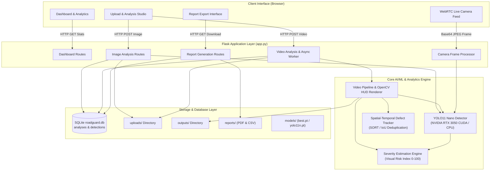
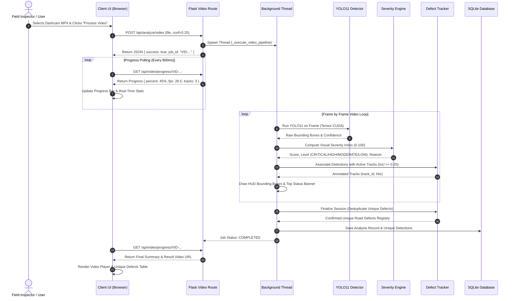

# ROADGUARD AI: System Architecture Specification
Version: 3.0.0 (Field Intelligence Release)

## 1. Executive Architecture Overview

ROADGUARD AI is an edge-optimized, modular computer vision system designed to detect roadway defects (potholes and structural cracking), track defect occurrences across consecutive video frames, compute empirical visual risk severity indices, and generate executive inspection reports.

The application adheres to clean separation of concerns:
- **Presentation Layer**: Field Intelligence Design System featuring modular CSS tokens (`design-system.css`, `layout.css`, `components.css`, `dashboard.css`, `analysis.css`, `responsive.css`), fixed vertical sidebar navigation with Lucide-style SVGs, Space Grotesk + Inter typography, high-contrast severity tiers, responsive desktop-to-mobile layouts, and interactive Chart.js visualizations.
- **Routing & Service Layer**: Flask modular blueprints providing RESTful endpoints, input validation, and asynchronous job monitoring across Command Center (`/`), Analysis Studio (`/analysis`), Road Intelligence (`/dashboard`), History (`/history`), and Reports (`/reports`).
- **Computer Vision & AI/ML Layer**: YOLO11 Nano object detection with automated hardware dispatch (NVIDIA CUDA GPU acceleration with CPU fallback) and strict road-damage taxonomy validation.
- **Severity Estimation Engine**: Empirical visual risk scoring module evaluating defect type, normalized relative bounding box area, lane perspective proximity, aspect ratio, and multi-frame persistence.
- **Multi-Object Tracking Engine**: Spatial-temporal defect association utilizing Intersection-over-Union (IoU) and centroid proximity to eliminate duplicate counting in video streams.
- **Reporting & Persistence Layer**: SQLite relational database for historical analyses and ReportLab engine for cryptographic-free, professional PDF and CSV generation.

---

## 2. End-to-End System Flowchart

---

## 3. Video Processing & Defect Tracking Sequence

---

## 4. Hardware Optimization & Memory Architecture

The system is configured specifically for standard workstation hardware:
- **Primary GPU**: NVIDIA GeForce RTX 3050 Laptop GPU (4,096 MB VRAM).
- **Host CPU**: AMD Ryzen 5 5600H (6 Cores, 12 Threads).
- **RAM**: 16 GB DDR4.
- **Operating System**: Windows 11.

### Memory Optimization Safeguards:
1. **CUDA Cache Management**: Explicit calls to `torch.cuda.empty_cache()` before multi-frame batch inference prevent CUDA Out-of-Memory (OOM) conditions within 4GB VRAM.
2. **Batch Pacing**: Video processing streams frames sequentially through OpenCV buffers rather than buffering entire uncompressed videos in system RAM.
3. **Graceful Fallback**: If CUDA drivers or GPU hardware are absent, `core/detector.py` automatically initializes inference on CPU without throwing uncaught exceptions.
